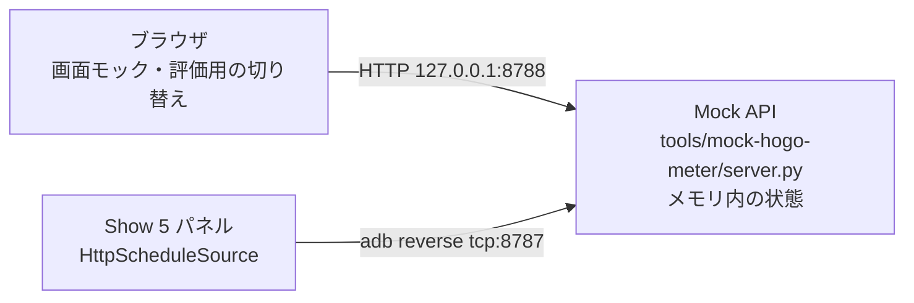

# 投薬予定の Mock API と画面評価 設計

2026-10-22。[PRD](prd.md) / [配置検討](../CALENDAR_INTEGRATION.md)。

## 概要

PC 上の Mock API（Python 標準ライブラリ）が、hogo-meter に足す予定の「機器向けの投薬予定 API」と「ダッシュボードの画面モック」を1つのプロセスで出す。パネルは ADB のポート転送で Mock API に届き、取った予定を今の警告判定（`ReminderPolicy`）に渡す。画面モックとパネルが同じ状態を見るので、両方の表示を並べて評価できる。



## 今の作り（調査結果）

- 予定は `MockData.occurrences` の固定リスト（`PanelModel.kt:10-13`）。`PanelModel` のコンストラクタで `private val occurrences` として受ける（`PanelModel.kt:72-77`）。差し替える経路は無い。
- 判定は `PanelModel.warnings()`（`PanelModel.kt:111`）→ `ReminderPolicy.warnings(occurrences, doneKeys, today)`（`ReminderPolicy.kt:48`）。系列ごとに「警告開始日が来た回のうち最新の1回」を選ぶ（`ReminderPolicy.kt:44`）。警告日数は `ReminderPolicy.WARN_DAYS_BEFORE = 2L`（`ReminderPolicy.kt:25`）を `warnStart`・`phase` が直接使う。
- `today` はシナリオの固定日（`PanelModel.kt:78`, `:299`）。本番の経路で `refreshDate` を呼ぶ箇所は無い。`ReminderPolicy.localDate(instant, zone)`（`ReminderPolicy.kt:30`）は未使用。
- 確認の題名と記録は、開いた回の key で `occurrences` を引き直す（`PanelModel.confirmTitle`、`recordMed` `PanelModel.kt:197`）。
- すべてメインスレッドの `Handler` で動く（`PanelRoot.kt:25`）。`pause()` で `removeCallbacksAndMessages(null)`（`PanelRoot.kt:54-64`）。毎分の `PanelTimer.TICK` は時計に入ると取り消される（`PanelController.kt:254`, `:295`）。明滅の予約は Controller の非公開 `syncTimers()`（`PanelController.kt:277`, `:316`）。
- 薬カードの配置は1〜2枚を前提にした高さ（`PanelLayout.kt:50`、アイコン 64px `PanelView.kt:87`）。時計の札は折り返し・幅の制限が無い（`FlipClockView.kt:173`）。
- 権限・ネットワーク設定・依存ライブラリは無い（JUnit だけ）。`android.useAndroidX=false`。JVM の単体テストでは Android の `org.json` はスタブになる。
- 常設の Show 5 には `scripts/install.sh` で debug APK を入れ、Wi-Fi ADB も使う（[BUILD.md](../BUILD.md)）。Android 11（LineageOS 18.1）の Show 5 で、debug アプリへの `adb shell "run-as <package> sh -c '…'"` が使え、標準入力も渡せることを 2026-10-22 に確認した（端末側のコマンド全体を引用で囲む。作業場所はアプリのデータ領域）。
- hogo-meter の機器向け API の一般的な作法（c6c14d6 で確認）: camelCase、時刻は UTC epoch 秒、エラーは JSON の `error` とステータス、対象外の任意キーは省く。ダッシュボードは明るい配色（背景 `#FBF7F0`、カード白、本文 `#2D2A26`、主色 `#C68B3E`、成功 `#7A9E7E`、警告 `#C0614A`、境界 `#E0D8CC`）、白い角丸カード、見出しは丸ゴシック。世帯の設定は縦並びのカード、機器の設定はデバイス詳細の「設定」タブ、トップはヘッダーの下にデバイスカードのグリッド。認証方式の詳細は連携元の文書を正とし、ここには書かない。

## 方針

- **Mock API は Python 3 の標準ライブラリだけ**（`http.server` の `ThreadingHTTPServer`、`json`、`unittest`）。PC に追加のインストールが要らず、Android のビルドと独立する。
- **パネルの届き方は `adb reverse tcp:8787 tcp:8787`。** パネルは `http://127.0.0.1:8787` に繋ぐ。LAN 上で Mock API を待ち受けなくて済む。平文の HTTP は debug ビルドの network security config で 127.0.0.1 だけに許す。
- **待ち受けを2つに分ける。** 8787 は機器向け API（`/api/agent/*`）だけで、これだけを `adb reverse` で端末へ転送する。画面モックと評価用の `/mock/*` は転送しない 8788 に置き、端末内のアプリから評価状態を変えられないようにする。
- **接続設定は `run-as` で書くファイル。** exported な Activity の起動 intent は他のアプリからも送れるので使わない。`run-as` は shell からだけ使え、秘密の値もコマンド行に出ない。
- **予定日は Mock API が基準日から作る。** 基準日は予定の並びを選んだ時点の日付で、選び直すまで変えない。パネルは端末の本当の日付（API のタイムゾーンでの日付）で判定するので、日付が進めば「そろそろ」→「今日」→「未確認」と自然に変わる。評価のためにパネルの日付を偽らない。
- **パネルは接続設定があるときだけ API を使う。** 無ければ今のシナリオの操作モックのまま。単体テスト112件の前提を壊さない。
- **JSON は Android の `org.json` で読む。** 単体テストのために `testImplementation("org.json:json:20240303")` を足す（実行時の依存は増えない）。読む前に入れ子の深さと大きさを確かめる。
- **画面モックは静的 HTML 1枚と小さな JS。** 上部のタブで「トップ」「カレンダー連携」「デバイス詳細」を切り替え、評価用の切り替え欄と要求の一覧を共用する。React や Tailwind は使わず、hogo-meter の色・余白・カードの形だけを CSS で寄せる。

選ばなかった案:

- パネルの日付を API から上書きする: 本番の経路と違う判定になる。
- 起動 intent の extras で接続設定を渡す: 他のアプリから接続先と秘密の値を差し替えられる（安全面のレビュー）。
- DUMP 権限付きの BroadcastReceiver: 安全だが、受け口のコードが増える。`run-as` で足りる。
- PC の LAN アドレスで Mock API を公開する: 平文の HTTP を LAN に許すことになる。
- hogo-meter の Next.js に画面を仮に作る: ユーザーの選択で見送り（静的 HTML）。
- 3枚の独立した HTML と、パネルの「今すぐ取得」メニュー: 評価には1枚の切り替えと短い取得間隔で足りる（レビューで削減）。

## 構成

```
tools/mock-hogo-meter/
  server.py          # HTTP サーバー。127.0.0.1:8787（機器向け API だけ）と 127.0.0.1:8788（画面モック・評価用）に固定
  push-config.sh     # 接続設定を端末へ書く（シリアル必須。秘密の値をコマンド行に出さない）
  mock_state.py      # 評価状態と、状態から応答を作る純粋関数（基準日・今日を引数で受ける）
  static/index.html, mock.css, mock.js   # 画面モック（1ページ、タブで切り替え）
  test_mock_state.py, test_server.py     # unittest
  README.md          # 起動・adb reverse・パネルの設定・評価の手順
app/src/test/resources/api/medications/*.json   # 応答の見本（両方のテストが読む）
app/src/main/kotlin/.../ScheduleSource.kt        # 取得結果の型・取得の抽象
app/src/main/kotlin/.../MedicationsJson.kt       # 応答の検証と読み取り（純粋関数）
app/src/main/kotlin/.../ApiConfig.kt             # 接続設定ファイルの読み取りと検証（純粋関数＋ファイル読み）
app/src/main/kotlin/.../HttpScheduleSource.kt    # HttpURLConnection での取得
app/src/main/kotlin/.../ScheduleFetcher.kt       # 取得の予約・同時1件・世代番号（Handler とスレッドを注入）
app/src/debug/AndroidManifest.xml                # INTERNET 権限と networkSecurityConfig
app/src/debug/res/xml/network_security_config.xml
docs/calendar-mock/api.md, verification.md
```

パネルのデータの流れ:

1. `MainActivity.onCreate` が `ApiConfig.load(filesDir)` を呼ぶ。ファイルが無ければシナリオモード。API モードではシナリオ選択・リセットのメニューを出さず（ヘッダーの長押しは何もしない）、`PanelModel.perform` もシナリオの操作を拒否する。あれば API モードで、`ScheduleFetcher` を作って `PanelRoot` に渡す。ファイルがあるのに不正なら API モードのまま「接続設定の誤り」を出し、取得しない（黙ってシナリオに戻さない）。設定の変更は `am force-stop` の後に起動し直して反映する。
2. `ScheduleFetcher` は `resume` で即時に1回取得し、取得を始めるたびに 15 秒後の見張りを自分の Handler に予約する（時間が来たら世代番号を進め、接続を切り、`Failed(TIMEOUT)` を渡す。接続・ヘッダー・本文のどこで止まっても効く）。以後は「前の取得が終わってから」次を予約する。間隔は成功時は応答の `pollSeconds`（無ければ 300 秒）、失敗時は最後に分かった `pollSeconds`（無ければ 30 秒）。取得は同時に1件だけ。`pause` と `onDetachedFromWindow` で世代番号を進めて予約を消し、作業中の要求の結果は捨てる。止めている間は再予約しない。
3. 取得結果はメインスレッドで `PanelController.onSchedule(result)` に渡す。Controller は、指が触れている間は結果を1件だけ保留し、全ての指が離れたら反映する。反映では `PanelModel.applySchedule(result, today)` を呼び、明滅の予約（`syncTimers`）と時計の札（`PanelHost.updateClockBadges()` を新設）を合わせ、再描画する。無操作の時間は変えない。
4. API モードでは、Controller が新しい `PanelTimer.DATE` を、ホームでも時計でも毎分予約する。API のタイムゾーン（未取得なら端末のゾーン）での今日を求め、変わっていれば 3 と同じ保留の経路に通す（指が触れている間は保留し、離した後の操作の処理を終えてから、または取り消し後に `refreshDate` と同期をする）。`resume` でもすぐに求める。シナリオモードでは今までどおり（`DATE` を使わない）。

## インターフェース

API の文書は [`docs/calendar-mock/api.md`](api.md) に置き（応答の見本は [`app/src/test/resources/api/medications/`](../../app/src/test/resources/api/medications/)）、以下を正とする。

### 機器向け API（案 v0）

`GET /api/agent/{deviceId}/medications`

要求ヘッダー: `X-Mock-Device-Secret`（Mock API が起動ごとに作る評価用の値。本番のヘッダー名・認証方式は hogo-meter 側で決める）。

成功 `200`、`Content-Type: application/json; charset=utf-8`、UTF-8 のバイト長の `Content-Length`。キーの規則: 知らないキーは無視する。`null` は省略と同じに扱う。数値は整数だけ（JSON の数値で小数点も指数も無いものが整数。`2.0`・`1e2`・文字列の数字は型違い）。同じオブジェクトに同じキーを 2 回出さない（出たら全体の失敗）。送り手は応答を 64 KiB 以内に収める（Mock は `ensure_ascii=False` の UTF-8 で書き出す。件数・長さの上限を全部使うと超えうるのは送り手の責任）。入れ子の深さはトップの `{}` / `[]` を 1 と数えて 8 まで。

| キー | 型 | 意味 | 省略 |
|---|---|---|---|
| `enabled` | boolean | この機器に投薬予定を出すか（デバイス詳細の設定） | 省略しない |
| `status` | string | 下の表。知らない値は `fetchFailed` と同じに扱う | `enabled:false` のとき省く |
| `leadDays` | integer | 警告を始める日数（世帯の設定値。初期値 2、0〜14。32 ビット符号付きの範囲外は型違い） | `enabled:false` のとき省く |
| `timeZone` | string | 予定のタイムゾーン。地域の ID（`Area/City` の形。例 `Asia/Tokyo`）と `UTC` だけ。`+09:00`・`UTC+9`・`Z` などのオフセット形式は全体の失敗。選んだカレンダーのもの | `notConnected` と `enabled:false` のとき省く。`enabled:true` で無いとき、パネルは端末のタイムゾーンで今日を決める（失敗にしない） |
| `fetchedAt` | integer | 最後に Google から取れた時刻（epoch 秒。0〜2^53−1） | 一度も取れていないとき省く |
| `pollSeconds` | integer | 次の取得までの推奨間隔（秒。32 ビット符号付きの範囲）。パネルは 10〜3600 に収めて使う | 省いてよい（パネルは 300 秒） |
| `occurrences` | array | 回の一覧（予定日の昇順、最大 200 件）。`notConnected` では空 | `enabled:false` のとき省く |

`occurrences[]`:

| キー | 型 | 意味 |
|---|---|---|
| `key` | string | 回の識別子（occurrenceKey）。実施の記録先。1〜128 文字の `[A-Za-z0-9._:-]` |
| `seriesId` | string | 系列（繰り返し予定の元）。単発の予定は `key` と同じ値。`key` と同じ文字の規則 |
| `name` | string | 薬名（予定の件名）。1〜40 コードポイント（Unicode。UTF-16 の単位ではない）。送り手（Mock・本番）は前後の空白と一般カテゴリ Cc・Cf の文字を除き、40 コードポイントまでに切って渡す。パネルは整形しない（trim しない） |
| `date` | string | 予定日（`timeZone` での暦日。単日の終日予定を対象とする）。`[0-9]{4}-[0-9]{2}-[0-9]{2}` に文字列全体が一致し（Python は `re.fullmatch`、Kotlin は `matches()`）、実在する日付 |
| `icon` | string | `pill` / `drop`。省略時・知らない値・文字列でない値は `pill`。決め方は未決（PRD） |

`key` の不変条件: 同じ回なら、再取得・件名の変更・予定日の移動・系列の一部の回だけの変更をしても変わらない（Google の回の ID が元の開始日から作られることを前提にする。本番の作り方は hogo-meter で確かめる）。別のカレンダーの同名の予定とは別の key になる。カレンダー ID をそのまま入れない（本番ではハッシュなどで伏せる）。Mock の ID は架空の値で、`key` は `occ-<カレンダー>-<系列>-<元の予定日 YYYYMMDD>`（例 `occ-cal1-F-20261024`）、`seriesId` は `ser-<カレンダー>-<系列>`（例 `ser-cal1-F`）。`<カレンダー>` は Mock の calendarId から作る（`mock-` を外してハイフンを除く。`mock-cal-1` → `cal1`、`mock-cal-2` → `cal2`）ので、カレンダーを切り替えると別の key になる。単発の予定も同じ形でカレンダーを含める（`occ-cal1-once-20261030`、系列は `once`。単発の `seriesId` は `key` と同じ値）。

`date` だけ epoch 秒にしない理由: 終日の予定は時刻を持たない暦日で、epoch 秒にするとタイムゾーンの解釈がずれる余地が増える。複数日の予定・時刻付きの予定は、サーバーが開始日の単日の予定として渡す。

**返す回の範囲:** 予定日が「今日の 7 日前」から「今日の 60 日後」までの回。7 は hogo-meter の世帯の設定値の想定（今回は Mock の設定値、パネルには配らない）。今回は実施を送らないので、サーバーは過去の回が済んだか分からない。7 日を過ぎた回は返さず、パネルの未確認の警告もそこで消える（PRD の「決まっていないこと」）。

状態ごとの意味と、パネルの扱い:

| status | 意味（サーバーが決める） | occurrences | パネルの状態表示 |
|---|---|---|---|
| `ok` | 最近 Google から取れている | 最新 | 出さない |
| `stale` | 取得は成功していたが古い | サーバーが最後に取れたもの | 予定が古い |
| `fetchFailed` | 直近の Google からの取得に失敗 | サーバーが最後に取れたもの | 予定を更新できません |
| `reauthRequired` | Google の認可が切れた | サーバーが最後に取れたもの | カレンダーの再接続が必要 |
| `notConnected` | 未接続、またはカレンダー未選択 | 空（切断・未選択で消す） | カレンダー未接続 |

「古い」とみなす時間はサーバーが決める（Mock は評価用の切り替えで直接選ぶ）。

エラー: `401 {"error":"unauthorized"}`、`404 {"error":"device not found"}`、`421 {"error":"misdirected request"}`（Mock の 8787 で `Host` が違うとき。パネルでは `HTTP_OTHER`）、`500 {"error":"internal error"}`。Mock は `Host`（421）→ パスの形（404）→ 秘密の値（401）→ `deviceId`（404）の順に確かめる。秘密の値を先に確かめるので、秘密を持たない相手には機器の有無が分からない。`Content-Type` が `application/json` でない 2xx のパネルの分類は `NOT_JSON`。

### パネルの検証と状態遷移

`MedicationsJson.parse(text, today)` は次を全体の失敗（`Failed(INVALID)`）にする: JSON として読めない、入れ子の深さが 9 以上（トップの `{}` / `[]` を 1 と数え、8 までは受ける。解析の前に数える。JSON の文字列の中の括弧とエスケープは数えない）、64 KiB を超える、同じオブジェクトの中で同じキーが 2 回出る、`enabled` が無い・boolean でない、`enabled:true` なのに `status`・`leadDays`・`occurrences` が無いか型が違う、`leadDays` が 0〜14 の外または整数でない、`timeZone` が文字列でない・地域の ID（`Area/City` の形）と `UTC` のどちらでもない（オフセット形式を含む。`ZoneId.of` に渡す前に形を確かめる）、`occurrences` が配列でない・200 件を超える、`key` が重複する。`timeZone` が無いときは失敗にせず、端末のタイムゾーンで今日を決める。

判定の順番: (1) 大きさ・JSON・深さ・同じキーの重複、(2) `enabled`（`false` ならここで終わる）、(3) `status`・`leadDays`・`timeZone`・`occurrences`、(4) `key` の重複、(5) 回ごとの除外、(6) 並べ直し。`key` の重複は、回ごとの除外の前に、`key` が文字列である要素どうしで判定する（あとで除かれる回どうしの重複も全体の失敗）。パネルは一覧の並びを確かめず、日付・`key` の順に自分で並べ直す。

個々の回で、要素がオブジェクトでない、`key`・`seriesId`・`name`・`date` が欠ける・型や規則に合わない、`date` が `[0-9]{4}-[0-9]{2}-[0-9]{2}` に文字列全体で一致しない（`matches()`）・実在しない日付、今日の −31〜+400 日の外、のどれかなら、その回だけを除く（1件のおかしな件名で全部を使えなくしない）。除いた件数は数えるが画面には出さない（ログにだけ件数を出す）。`name` の長さは Unicode のコードポイントで数え（Mock とパネルで同じ）、次のどれかなら除く: 一般カテゴリ Cc・Cf の文字を含む、対になっていないサロゲートを含む、すべての文字が Unicode の White_Space（空白だけ）、40 コードポイントを超える。パネルは名前を整形しない（trim しない）。`icon` が文字列でないときは `pill`。任意のキー `pollSeconds`・`fetchedAt` の型違い（小数・指数・文字列の数字・範囲外の整数）は、そのキーを省いたものとして扱う（全体の失敗にしない）。`enabled:false` の応答は `pollSeconds` 以外を読まない（JSON としての検査と `enabled` の型は行う）。

```kotlin
enum class FetchError { NETWORK, TIMEOUT, HTTP_401, HTTP_404, HTTP_OTHER, REDIRECT, NOT_JSON, TOO_LARGE, INVALID }
sealed interface ScheduleResult {
    data class Loaded(val status: SourceStatus, val leadDays: Int, val zone: ZoneId?, val fetchedAt: Long?,
                      val pollSeconds: Int?, val occurrences: List<Occurrence>) : ScheduleResult
    data class Disabled(val pollSeconds: Int?) : ScheduleResult
    data class Failed(val error: FetchError) : ScheduleResult
}
```

`PanelModel` が持つ API モードの状態と遷移:

| 今 → 受けた結果 | 予定の一覧 | 警告日数・ゾーン | 表示 |
|---|---|---|---|
| 起動直後（未取得） | 空 | 2・端末のゾーン | 状態「予定を取得中」 |
| → `Loaded(ok)` | 置き換える | 応答の値 | 状態なし |
| → `Loaded(stale / fetchFailed / reauthRequired)` | 置き換える（サーバーのキャッシュ） | 応答の値 | 各状態 |
| → `Loaded(notConnected)` | 空にする | 応答の値・端末のゾーン | 「カレンダー未接続」 |
| → `Disabled` | 空にする | そのまま | 薬カード・時計の札・状態を出さない |
| → `Failed`（前に `Loaded` あり） | 残す | 残す | 「予定を取得できません」 |
| → `Failed`（未取得・`Disabled` の後） | 空のまま | そのまま | 「予定を取得できません」 |
| 接続設定の誤り | 空 | 2・端末のゾーン | 「接続設定を確認してください」、取得しない |

- 実施済み（`doneKeys`）は差し替えても残す。新しい一覧に無い key は判定に出ないだけ。評価をやり直すときは `am force-stop` で消える（メモリ内だけ）。
- `Confirmation` に、開いた時点の `Occurrence` を持たせる。題名と `recordMed` はこの回を使い、一覧を引き直さない。
- `warnings()` は `ReminderPolicy.warnings(occurrences, doneKeys, today, leadDays)`。`ReminderPolicy` の `warnStart`・`phase`・`warnings` は `leadDays` を引数で受け、初期値の引数に `WARN_DAYS_BEFORE` を使う（シナリオモードと未取得のときだけ使われる）。
- 薬カードは最大 2 枚。警告が 3 件以上なら、段階（未確認 → 今日 → そろそろ）と予定日の順で 2 件を出し、2 枚目のカードの下に「ほか N 件」と小さく出す。時計の札も 2 件と「ほか N 件」。薬名はカード・札の幅に収まらなければ末尾を「…」で切る。
- 状態の表示はヘッダーの右、時刻の左に小さな文字で1行。色はテラコッタ系の控えめな色。時計には出さない（時計は薬名だけの既存方針）。

### 通信（`HttpScheduleSource`）

- URL は `<baseUrl>/api/agent/<deviceId>/medications`。`deviceId` は URL エンコードする。
- 接続 5 秒、読み取り 1 回 10 秒。全体 15 秒は `ScheduleFetcher` の見張りで守る（読み取りの間隔が短い遅い応答でも止まらない）。
- `instanceFollowRedirects = false`。3xx は `REDIRECT`。`Content-Type` の種類が（大文字・小文字を区別せず、`; charset=` などを除いて）`application/json` でなければ `NOT_JSON`。
- 読んだバイト数を数えて 64 KiB で打ち切る（`Content-Length` を信じない）。2xx 以外の本文は読まない。
- `fetch()` は `Throwable` まで捕まえて `Failed` にする。`Failed` には決まった種類だけを入れ、例外のメッセージ・URL・ヘッダーをログに出さない。

### 接続設定（`run-as` で書く）

```
adb -s <serial> reverse tcp:8787 tcp:8787
tools/mock-hogo-meter/push-config.sh <serial>   # 中で次を行う
#   adb -s <serial> shell "run-as io.github.ysogabe.hogo.panel sh -c 'umask 077; mkdir -p files && cat > files/api-config.json.tmp && mv files/api-config.json.tmp files/api-config.json'" < <設定ファイル>
#   adb -s <serial> shell "run-as io.github.ysogabe.hogo.panel ls -l files/"   # 中身は表示しない
adb -s <serial> shell am force-stop io.github.ysogabe.hogo.panel
adb -s <serial> shell am start -n io.github.ysogabe.hogo.panel/.MainActivity
# 解除
adb -s <serial> shell "run-as io.github.ysogabe.hogo.panel rm files/api-config.json"
```

`api-config.json` は Mock API が起動時に書き出す（`{"baseUrl":"http://127.0.0.1:8787","deviceId":"mock-panel-1","secret":"<起動ごとの乱数>"}`）。秘密の値は `secrets.token_urlsafe(32)`。`tempfile.mkdtemp()`（0700・推測できない名前）の中に `O_CREAT|O_EXCL`・0600 で作り、Ctrl-C・SIGTERM・`atexit` で消す。起動時にはファイルのパスと `push-config.sh` の使い方だけを表示し、秘密の値は表示しない。異常終了で残っても、値は起動ごとに変わるので使えない。手で秘密の値を打たない。`adb shell -t`（疑似端末で入力が画面に出る）は使わない。端末側の作業場所はアプリのデータ領域で、0700 の領域に置かれる。

`ApiConfig` の検証: 3つのキーがすべてそろう。`baseUrl` は `http://127.0.0.1:<port>` だけ（パスなし）。`deviceId` は `[A-Za-z0-9_-]{1,64}`。`secret` は 16〜256 文字の印字可能 ASCII。ファイルは 4 KiB まで。一つでも外れたら「接続設定の誤り」。ログにはどの規則に外れたかだけを出し、値は出さない。

### Mock API の評価用エンドポイントと画面モック

- 8787: `GET /api/agent/{deviceId}/medications` だけ。他のパスは 404。
- 8788: `GET /` 画面モック（`static/index.html`）、`GET /static/mock.css`、`GET /static/mock.js`。配るファイルは固定の一覧だけで、パスからファイル名を組み立てない。
- `GET /mock/state`、`POST /mock/state`（JSON で部分更新）、`GET /mock/requests`（パネルからの直近 50 件の要求: 時刻・パス・ステータス・応答のバイト数）。秘密の値は状態にも要求の一覧にも入れない。
- すべての要求で `Host` がそのポートの `127.0.0.1:<port>` か `localhost:<port>` でなければ 421。8788 の POST は `Origin` が同じもの（`http://127.0.0.1:8788` か `http://localhost:8788`）だけ、無ければ 403。`Content-Type: application/json` 必須、本文は 16 KiB まで。`json.loads` で NaN・Infinity を拒み、知らないキー・型違い（`bool` を整数として受けない）は 400。
- 秘密の値の比較は `hmac.compare_digest`。`log_message` を上書きし、ヘッダーと例外の中身を出さない。待ち受けアドレスを変える起動オプションは作らない。
- 評価状態（初期値）: `preset`（`normal`）、`baseDate`（起動日。`preset` を選ぶと今日に更新。日付を直接指定もできる）、`status`（`ok`）、`calendarId`（`mock-cal-1`。選べるのは `mock-cal-1` と `mock-cal-2`。key の `<カレンダー>` はここから作る）、`enabled`（true）、`leadDays`（2）、`pastDays`（7）、`fault`（`none` / `unauthorized` / `serverError` / `slow`（12 秒待つ）/ `malformed` / `deepNesting`）、`pollSeconds`（15）、`timeZone`（`Asia/Tokyo`）。
- 画面モックの上部に、点線で囲んだ評価用の切り替え欄（「評価用（本番には無い）」と明記）と要求の一覧を置く。各タブには、画面ごとの期待表示を小さく添える。

予定の並び（基準日 B、系列 F=フィラリア（pill）・L=フロントライン（drop）・M=長い薬名（pill）、それぞれ毎月の繰り返し）と、今日 = B、警告日数 2 のときにパネルが出すはずの警告:

| preset | 返す回の予定日 | 期待する警告 |
|---|---|---|
| `normal` | F: B+10, B+41 | なし |
| `soon` | F: B+2, B+33 | F(B+2) そろそろ |
| `today` | F: B, B+31 | F(B) 今日 |
| `overdue` | F: B−1, B+30 | F(B−1) 未確認 |
| `expired` | F: B+22（B−8 は範囲外で返さない） | なし |
| `two` | F: B+2, L: B | L 今日、F そろそろ |
| `three` | F: B+2, L: B, M: B−1 | M 未確認、L 今日（カード 2 枚）＋「ほか 1 件」 |
| `longName` | M（40 文字の薬名）: B | M 今日（末尾を「…」で切る） |
| `none` | なし | なし |

日付が進めば、同じ回のまま段階が変わる（例: `soon` を選んで 2 日後は今日）。「次の回の警告が始まったら古い未確認を繰り上げない」などの系列の判定は、日付を固定した単体テストで確かめる（評価の並びには入れない）。

画面モックの各タブの内容:

- **トップ:** ヘッダーの下に「直近の投薬予定」カード（今日の 7 日前から 30 日後まで、最大 5 件、日付と薬名、過ぎたものは「過ぎています」）。その下に架空のデバイスカード（パネルのカードには「投薬表示: オン/オフ」）。未接続なら「カレンダー未接続」と設定への導線。パネルで実施済みにしても、ここには残る（今回の期待動作として明記）。
- **カレンダー連携:** 接続状態（未接続・接続済み・再接続が必要・取得失敗・古い）、「Google と接続」「切断」ボタン（見せかけ）、架空のカレンダー一覧（「ねこの投薬」「家族」）からの選択、警告を始める日数（表示のみ。「初期値 2 日」）、最後に取れた時刻。
- **デバイス詳細:** 「設定」タブ内に「投薬の予定を表示する」のスイッチ。

## データ

- Mock API: メモリ内だけ。再起動で初期状態と新しい評価用の値。架空の薬名と架空のカレンダー名・ID（`mock-cal-1`）。
- パネル: 接続設定のファイルだけを端末のアプリ専用領域に置く。予定と実施はメモリ内だけ（今と同じ）。`allowBackup="false"` は今のまま。

## 安全面

前提: 常設の Show 5 で動くのは debug APK で、Wi-Fi ADB（暗号化されない TCP）も開いている。「debug ビルドに限る」は release への混入を防ぐだけで、実機の守りにはならない。今回守れるのは「架空データ」と「起動ごとに変わる評価用の値」だけで、それで足りるように作る。

- 接続設定は `run-as`（shell からだけ使える）でファイルに置く。exported な受け口を足さない。`baseUrl` は 127.0.0.1 の http だけを受け付け、他のアプリが接続先を差し替える経路を作らない。
- `INTERNET` 権限と network security config は `app/src/debug` にだけ置く。config は `127.0.0.1` だけを `includeSubdomains="false"` で平文を許し、それ以外は既定（平文を許さない）。BUILD.md に、`assembleRelease` の APK を `aapt2 dump xmltree`（または `apkanalyzer manifest print`）で調べ、`INTERNET`・`networkSecurityConfig`・`usesCleartextTraffic` が無いことを確かめる手順を足す。
- `adb reverse` が切れている間は、端末の 127.0.0.1:8787 を端末内の他のアプリが待ち受けられ、パネルは評価用の値をそこへ送り、偽の予定を受けうる。また Wi-Fi ADB の上の通信は LAN 上で平文。評価用の値は起動ごとに変わり、データも架空なので、今回は許容する。本番では localhost の平文に秘密を載せない。
- Mock API: 127.0.0.1 だけで待ち受ける。端末へ転送するのは機器向け API の 8787 だけで、評価状態を変える 8788 は端末内のアプリから届かない。Host と Origin を確かめる（ブラウザからの DNS rebinding と CSRF への備え。端末内のアプリはヘッダーを自由に付けられるので、これで守れるのはブラウザだけ）。静的ファイルは固定の一覧。入力は型と範囲を厳しく確かめる。秘密の値は応答・状態・要求の一覧・ログに出さない。
- パネル: 64 KiB・全体 15 秒（見張り）・リダイレクトを追わない・入れ子の深さ・`Throwable` まで捕まえる。取得は同時に1件。`pollSeconds` は 10〜3600 に収める。
- 公開してよい記録だけを残す: 検証記録・README では端末のシリアル・アドレス・ポート・PC のユーザー名やパス・評価用の値を `<serial>` などに置き換える。スクリーンショットは端末の画面・ブラウザのページ部分だけを切り出し、コミットの前に目で確かめる。見本の ID は `mock-cal-1`、`occ-…` のように一目で架空と分かる形にする。

本番（hogo-meter）へ引き継ぐ注意（`CALENDAR_INTEGRATION.md` にも足す）:

- 起動 intent や exported な受け口で設定する経路を持ち込まない。常設端末で debuggable なビルドと TCP ADB を併用しない。
- 機器ごとに失効・更新できる資格情報にし、共有の値を全機器で使わない。秘密のヘッダーをサーバーのログに出さない。
- 認証の失敗でリダイレクトやログイン画面の HTML が返る場合も、取得失敗として扱う。
- `enabled:false` や `notConnected` は警告を消す方向に働く。ダッシュボードで表示オフの機器と未接続を目立たせる。
- 実施を送るときは冪等キーを付け、自動で送り直さない（[KNOWLEDGE_HANDOFF.md](../KNOWLEDGE_HANDOFF.md)）。

## テスト計画

| AC | 確かめ方 |
|---|---|
| AC1 | [`api.md`](api.md) と見本 JSON（`ok` / `stale` / `fetchFailed` / `reauthRequired` / `notConnected` / `disabled` / `error-401`）の突き合わせをレビューで確認 |
| AC2 | `python3 -m unittest`（`tools/mock-hogo-meter`）: 見本と同じキー・型。key・seriesId が ID の作り方（単発を含む）に合い、カレンダーを切り替えると key が変わる。基準日を固定して preset ごとの返す回（上の表）と、`pastDays`・範囲の境界。月末・年末・うるう日の基準日。`Content-Length` がバイト長。Host 違いが 421、秘密の値の違いが 401（`deviceId` が違っても秘密が違えば 401。404 は秘密が正しいときだけ）、Origin なし・違いの POST が 403、8787 に `/mock/*` と画面が無い、一時ファイルが 0600 で作られ終了時に消える、型違い・知らないキーが 400、`../` などのパスが 404。状態と要求の一覧に秘密の値が無い。待ち受けが 127.0.0.1 |
| AC3 | `MedicationsJsonTest`: 見本ごとの読み取り、`leadDays=3` で 3 日前から警告、全体の失敗の各条件（深い入れ子を含む。文字列の中の括弧は数えない。同じキーの重複、オフセット形式の `timeZone`）、1件だけおかしな回の除外、知らないキー・知らない `status`・`icon` の扱い、絵文字（UTF-16 で 2 単位）を含む 40 コードポイントの名前が受け入れられ 41 コードポイントは除かれること |
| AC3 | `ApiConfigTest`: 正しい設定、欠けたキー、`https://` や他のホスト、パス付き、短い秘密、大きすぎるファイル |
| AC4 | 接続設定なしで既存の 112 件が通る（`./gradlew testDebugUnitTest`）。追加分は件数を分けて報告する |
| AC5 | `PanelModelTest` に追加: 状態遷移の表の各行、確認中の差し替えで題名と記録先が変わらない、差し替え後も実施済みが残る、警告 3 件で 2 件と「ほか 1 件」 |
| AC5, AC7 | `PanelControllerTest` に追加（偽の取得元・予約先・時計）: 指が触れている間の保留と離した後の反映（取得結果と日付の変更の両方）、API モードでシナリオの操作が拒否される、無操作の時間が変わらない、明滅の開始・停止、時計の札の更新 |
| AC6 | `PanelControllerTest`: 時計の表示中に `DATE` で日付が変わり、そろそろ → 今日、時計の札も更新。`Failed` の後でも同じ |
| AC7 | `ScheduleFetcherTest`（偽の Handler 相当とスレッドを注入）: 同時1件、15 秒の見張りで `Failed(TIMEOUT)`、止めた後の結果を捨てる、止めている間は予約しない、成功・失敗ごとの間隔、`pollSeconds` を 10〜3600 に収める |
| AC8, AC9 | 手動: ブラウザで画面モックを操作し、`/mock/requests` と Show 5 の表示で反映を確認。各状態のスクリーンショットと対応表を `verification.md` に記録 |
| AC10 | `PanelControllerTest`: API モードで時計からの最初のタッチが記録されない |

ビルドと lint: `./gradlew testDebugUnitTest assembleDebug lintDebug`。release の APK の検査（安全面）。

## リスクと対策

- **adb reverse が切れる:** 端末の再接続でポート転送が消える。README に再設定の手順を書く。パネルは「予定を取得できません」を出して前回の予定で動き、転送が戻れば次の取得で回復する（実機で確かめる）。
- **取得中に画面が止まる:** 通信は必ず作業用スレッド。メインスレッドでは待たない。Mock の `slow` は `ThreadingHTTPServer` なので画面モックは止まらない。
- **既存テストの前提（警告日数 2・シナリオ日付）が崩れる:** 判定関数は初期値の引数を 2 にし、シナリオモードの動きを変えない。
- **PC と端末の時計がずれる:** 基準日は PC の日付、判定は端末の日付。評価の前に両方の日付を確かめる手順を README に書く。
- **画面モックが本物と離れる:** 色と配置だけを寄せたモックであることを画面に明記し、評価の記録でも区別する。

## 実装の順番

1. API の文書（`api.md`）と見本 JSON。以後の両方の作業の基準にする。
2. Mock API（`mock_state.py`・`server.py`・unittest）。curl で確かめられる。
3. パネルの判定と読み取り（`ReminderPolicy` の警告日数の引数化、`MedicationsJson`、`ApiConfig`、`PanelModel` の API モードの状態と `applySchedule`、`Confirmation` の回の保持、カード 2 枚と「ほか N 件」、単体テスト）。1 だけに依存し、2 と並行してよい。
4. パネルの通信と配線（`HttpScheduleSource`、`ScheduleFetcher`、`PanelController.onSchedule` と `DATE`、`PanelHost.updateClockBadges`、状態の表示、`MainActivity` の設定の読み込み、debug のマニフェストと network security config、BUILD.md の release 検査）。3 に依存。
5. 画面モック（1ページ・3タブ・評価用の切り替え欄・要求の一覧）。2 に依存。
6. 実機とブラウザでの評価、`verification.md`、README・BUILD・バージョン（0.3.0）、`CALENDAR_INTEGRATION.md` への引き継ぎの注意の追記。全部に依存。
