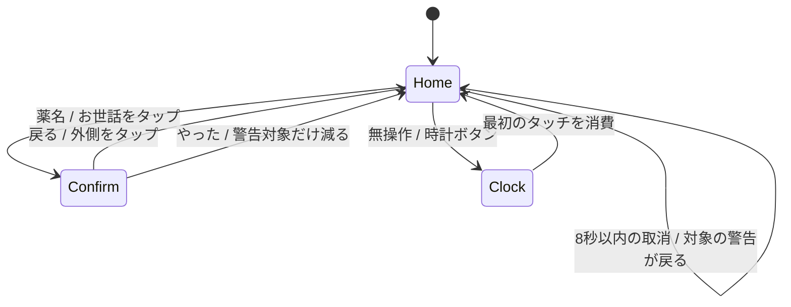

# 投薬を思い出すパネル — 画面設計（改訂3）

2026-10-18 / [要求](prd.md) / [操作モック](prototype.html)。ユーザーの「文字が多い」「次回の日付は不要」「パッと見て思い出せればいい」「予定の二日前から警告」を反映した再設計。さらに「普段は保護メーターだけ」「いつもと違う画面の方が目立つ」という希望を反映し、警告中だけ投薬画面が現れるようにする。

## 画面と遷移

960×480。普段はhogo-meterのお世話3項目を横一列に大きく置く。警告対象がある場合だけ、左にフィラリア・フロントライン等の対象カード、右に小さなお世話3項目へ配置を切り替える。薬が1つなら左の大きなカード1枚、2つなら2枚。上部は猫の名前と現在時刻、時計ボタンだけ。日付は表示しない。

- **ホーム:** 普段は薬名・薬カード・次回日付を出さない。2日前から画面を切り替え、琥珀色の「そろそろ」、当日は「今日」、過ぎたら赤系の「未確認」。実施を記録した薬はカードごと消す。全て記録したら普段のお世話だけに戻る。
- **確認:** 薬名と「戻る」「やった」の2操作。実施済みカードは主画面に残さない。初期フォーカスは「戻る」に置く。日々のお世話も同じ短い確認。
- **結果:** ホームへ戻り、8秒だけ「薬名＋記録しました／取消」。取消で警告が再び現れる。取消後は「取り消しました」。確認画面や時計を開くと取消の受付を閉じる。
- **時計:** フリップ時計の下に、警告対象の薬名だけを琥珀色の札で添える。通常・済の薬名は出さない。通知文や件数は置かない。

確認画面は開いてから450ms、実施ボタンを無効にし、処理側にも同じ時間判定を置く。カードの2回目のタップが背後の位置と重なっても即記録しない。戻る・閉じるはすぐ受け付ける。閉じたら有効化の予約を解除する。

時計の最初のタッチは、指が離れるまで一連のジェスチャーを消費する。時計への切替境界でも同様。HTMLモックはクリックで復帰を表す。Android段階の実機検証範囲は下記と[検証記録](verification.md)を参照。

## 2日前の判定と実施記録

予定の対象地域における `scheduledDate - 2暦日` の00:00から警告する。20日が予定日なら18日から「そろそろ」。予定日の翌日以降も、その回の記録がない限り「未確認」。時刻・残り日数・次回日付は見せない。モックは2026-10-20を予定日とし、3日前・2日前・当日・翌日を外側の切替ボタンで再現する。実時間は進めない。

内部状態は `normal / soon / today / late / done`。`normal` と `done` は投薬カードを描画しない。`soon / today / late` が1つ以上ある場合だけ警告レイアウトを使う。元予定は外部の定義を正とし、実施は `occurrenceKey` ごとに別保存。「やった」は明示的な自己申告で、予定日や次の周期を自動変更しない。記録済みなら警告より優先する。モックは各薬1回分だけを固定保持し、次の回の生成は省略する。実施後はその回のカードを非表示にする。

系列の表示対象は、警告開始日が到来した回のうち日時が最新の回を、完了状態を問わず選ぶ。新しい回を完了しても古い回を同じカードや時計の警告へ繰り上げない。過去の未確認は保存するが主画面に件数を並べない。過去履歴は別画面として後段で検討する。警告開始前は取得・保持だけ行い、薬を主画面に出さない。

確認を開いた時点の `occurrenceKey` にだけ記録し、データ更新で対象を別の回へ差し替えない。取消は結果表示の8秒以内に限り、このモックからはそれ以後の履歴操作はできない。将来の過去履歴は主画面から分離して設計する。実連携の取消は記録IDと版を確認した打ち消し操作とし、古い状態を無条件に復元しない。実施は現在警告表示中の回へ記録する。通常期間は薬の操作導線を出さない。配置の自動切替は進行中のタッチを終えてから反映し、確認中の対象は維持する。

## 既存コードと将来の連携

実装前のHogo Panel `f5f7fbd` は時計のみのAndroid PoC。既存の`MainActivity.kt`、`FlipClockView.kt`、`ClockModel.kt`を引き継ぎ、Android段階で待機・復帰・操作画面を組み込んだ。

予定取得 `ScheduleSource`、回ごとの保存 `ExecutionRepository`、2日前の判定 `ReminderPolicy`、画面状態 `PanelUiState`、時計との遷移 `IdleController` を分ける。Googleは専用カレンダーの読み取りを第一候補とし、元の回の識別と端末側の実施を分ける。Tasksの時刻・繰り返しに関する前回調査の制約は継承し、接続段階で再確認する。

日々のお世話は別の `CareSource` でhogo-meterへ記録する。投薬カードの「やった」ではhogo-meterの別項目へ自動送信しない。本番の記録・取消は実APIの成功後に反映する。今回のモックはメモリ内の操作だけ。

## 通信と安全面

HTMLモックは固定の架空データとインラインCSS/JSだけで、Androidモックも架空データ・メモリ内のみとし、外部通信・認可・永続保存をしない。実連携の薬名・周期は利用者設定。薬量や投薬手順は案内しない。端末情報や本番の記録を公開ファイルに入れない。

実連携では未取得・古い情報・認可エラーと、通常・済を区別し、成功していない記録を済にしない。詳しい接続情報は設定側へ寄せ、主画面は短い状態だけにする。エラー表示、Google認可・トークン・アカウント分離は前案の安全方針を引き継いで接続段階で設計する。

時計への薬名表示は、旧案の件数だけの待機通知を置き換える承認済みの方針。見て思い出せることを優先する。バックライトを自動で明るくしたり、音で割り込む動作は追加しない。点滅も、当日・超過のホームの薬カードを除いて追加しない（次項）。警告がなければ既存の低輝度時計だけにする。[IDLE_CLOCK.md](../IDLE_CLOCK.md)にも反映した。

## Android 操作モック

2026-10-18。ユーザーが改訂3の案を承認し、HTML段階からAndroidのモック実装へ進めた。この節がAndroid段階の実装状態を表す。外部通信なし・架空データ・永続保存なしは変えない。Show 5実機（960×480）でADB入力とスクリーンショットによる主要表示・遷移、3分待機、輝度指定と復帰を確認した。人の指や肉眼の低輝度評価は未確認（[検証記録](verification.md)）。

### 構成

純 Kotlin（`android.*` に依存しない。JVM の単体テスト対象）と、Android の描画・入力を分けた。

| 役割 | ファイル | 内容 |
|---|---|---|
| 判定 | `ReminderPolicy.kt` | 予定日の2暦日前から警告する `LocalDate` の判定、系列ごとに最新の到来回を選ぶ |
| 状態 | `PanelModel.kt` | 架空データ、シナリオ、確認、記録、取消トースト、待機。時刻は単調増加のミリ秒を引数で受ける |
| 配置・当たり判定 | `PanelLayout.kt` | 基準 960×480 の矩形、縮尺、タッチ対象の判定 |
| 入力の流れ | `PanelController.kt`, `TouchGate.kt` | タッチ・キー・戻る・タイマーを状態へつなぐ。復帰ジェスチャーの消費 |
| 描画 | `PanelView.kt`（Canvas） | HTML 相当の配色・余白・階層。描くだけで状態を持たない |
| 中継 | `PanelRoot.kt`, `MainActivity.kt` | ホームと既存 `FlipClockView` を重ね、Handler のタイマーとタッチを中継、輝度を切替 |

画面は dp でなく基準 960×480 の物理 px で作り、View の大きさに合わせて縦横比を保って縮尺する（960×480・density 195 では倍率1.0）。時計は既存の `FlipClockView`（桁・フリップ・移動・濃淡は変更なし）で、薬名の札だけを時計の下に描き足した。

### 規則

- **日付:** 予定日（固定の架空日 2026-10-20）と、シナリオが決める日付は壁時計とは別。ヘッダーの時刻と時計だけが実時間で、日付は画面に出さない。判定は `scheduledDate - 2暦日` で、48時間でなく予定地域の `LocalDate`（`ReminderPolicy.localDate(instant, regionZone)`）。月・年・うるう日をまたいでも暦日で数える。
- **配置:** 警告対象が1つでもあれば左に薬カード・右に小さなお世話、全て実施すれば3列に戻る。1件だけ残ればカード1枚を高さいっぱいに表示する。自動の配置切替は、日付の進行ではなくシナリオ選択・記録・取消の操作でだけ起きる。
- **確認:** 薬/お世話のタップで名前と「戻る」「やった」だけを出す。初期フォーカスは「戻る」。外側・戻る・Android Back は未記録。開いた直後450msは「やった」を無効にし、タップは吸収される。記録処理（`PanelModel.confirm`）も時刻を再判定する。閉じれば有効化の予約（タイマー）を取り消す。押し始めと離した位置が同じ有効なボタンのときだけ操作とする。
- **記録:** 開いた時点の `occurrenceKey` の回だけに記録し、idempotent。他の薬・別の回・お世話に影響しない。確認中に日付が進んでも対象は変わらない。
- **取消:** 「薬名 記録しました／取消」を8秒。取消は対象だけを戻し、トーストは「取り消しました」に変わるが同じ固定サイズ・同じ期限で残り、下の面へのタップを通さない。確認や時計を開くと取消の受付を終える。
- **時計:** 3分無操作または時計ボタン。警告期間の薬名の札（実施済みは出ない）。最初のタッチは全指のUP/CANCELまで消費してホームへ戻るだけ。指が触れている間は時計へ切り替えない。ポーズ・停止・デタッチで全タイマーと時計の描画予約を止め、`onResume` はホームから待機を数え直す。

### 試用とシナリオ

通常起動は「普段」（お世話3項目のみ）。ヘッダー（時計ボタンを除く）を約0.7秒長押しすると、「モック：シナリオ選択」が出る。**普段 / 2日前 / 当日 / 過ぎたら / 実施後 / 時計 / リセット**と閉じる。アプリ表示名も Hogo Panel Mock。主画面には試用用の部品を置かない。詳しい手順と状態は [BUILD.md](../BUILD.md#操作モックの試し方020)。状態はメモリ内のみで、プロセスの再起動で初期化する。

### 当日・超過の明滅（0.2.1）

ユーザーの追加指示により、旧仕様の「点滅しない」は **ホームの薬カードの「今日」「未確認」だけ**の例外とする。

- カード背景と枠の色が、約2.4秒で明→暗→明とゆっくり往復する（最も暗いときは背景を地の色へ約55%、枠を約45%寄せる）。文字・薬名・状態・アイコンの色は変えず、画面全体・バックライト・時計の札は明滅しない。
- 「2日前（そろそろ）」・普段・全実施後は静止。時計は IDLE_CLOCK.md のとおり静止のまま。
- 判定は `ReminderPolicy` の結果（未記録の `TODAY`・`LATE` のカードがあるか）だけを使う。「やった」で対象の薬が消えれば動きも止まり、取消で戻る。
- 位相は `SystemClock.elapsedRealtime`（単調時間）。更新は約30fps（33ms）の `PanelTimer.PULSE` だけで、ホームに明滅対象があり、確認・メニューが閉じているときだけ予約する。確認・メニュー・時計・pause・デタッチで取り消し、取り消した後に届いたコールバックは再予約しない。resume は必要なときだけ再開する。
- HTML 案は同じ周期の CSS アニメーション。`prefers-reduced-motion` では静止し、確認ダイアログ表示中は止まる。非表示タブはブラウザが自動で抑制する。
- 試し方: シナリオ選択の「当日」「過ぎたら」で明滅、「2日前」「実施後」「時計」で静止、確認を開くと止まり、戻る・取消で再開する。実機の見え方（指での操作・実際の輝度・夜の明るさの印象）は親が確認する。

### 制約と未実装

- 実機画像で配置・日本語フォント、ADB入力で主要タッチ遷移と輝度指定を確認済み。人の指の連打・複数指・境界、肉眼の低輝度の見やすさや長時間の残像は未確認。描画はCanvasの直接描画で、TalkBack用のアクセシビリティ情報は付けていない。
- キー操作は Tab/方向キー/Enter/Esc の最小限（確認の中のみ）。
- 状態は Activity と同じプロセス内のメモリにある。マニフェストの `configChanges`（向き・画面サイズ等）に含まれない構成変更（言語・フォント倍率・密度など）で Activity が再生成されると、記録と取消は初期化される。モックのため許容した。
- 実際の投薬予定・記録、Google・hogo-meter、設定画面（待機時間の変更）、過去履歴は未実装。

## 検証と次の段階

[verification.md](verification.md)にHTMLとAndroidの確認を分けて記録した。AC1〜AC6はAndroidの単体テストと実機の主要表示・操作でも確認。実機で札に気づけるか・低輝度での読みやすさ、人の指の境界操作、永続保存と実APIは次段階。

1. HTML 段階: 文字を絞った画面案と2日前の警告・実施確認（完了）。
2. Androidのモック実装（完了。実機で主要表示・遷移を確認済み、未確認項目は検証記録に明示）。
3. hogo-meter、Google、家族共有を順に追加。
