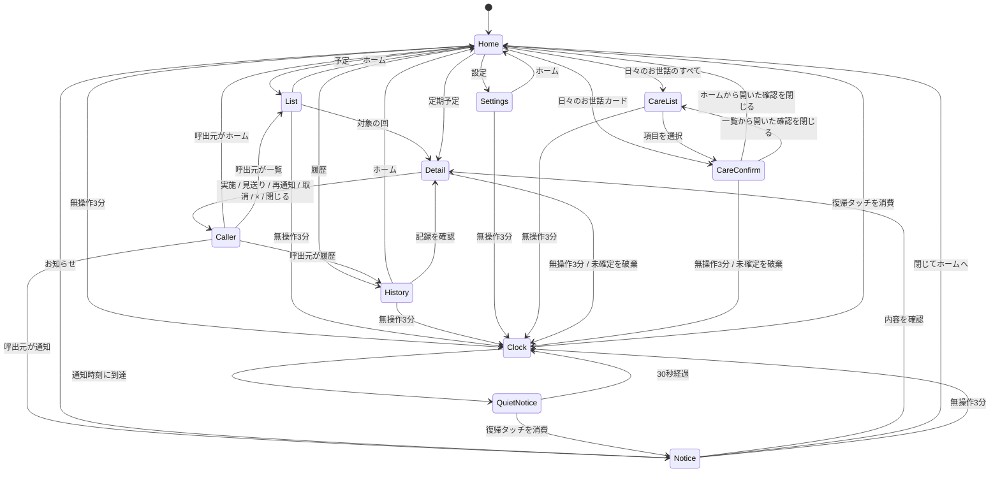

# 猫のお世話と定期予定の統合 UI — 設計案

2026-10-18 / [PRD](prd.md) / [操作モック](prototype.html)。本書は提案であり、Android 実装済みの仕様ではない。

## 今の作りと変更範囲

Hogo Panel `f5f7fbd` を基準とする。`app/src/main/kotlin/io/github/ysogabe/hogo/panel/MainActivity.kt:21` が時計を前面で開始し、`FlipClockView.kt:34` と `ClockModel.kt:28` が描画予約・フリップを管理する。`docs/IDLE_CLOCK.md:5` のとおり、現段階は起動直後から時計のみで、待機測定・タッチ復帰・操作画面・通信はまだない。ビルドは `./gradlew testDebugUnitTest assembleDebug lintDebug`（`docs/BUILD.md:12`）。本変更は設計資料とHTMLモックのみ。

## 方針と代案

**推奨: 一枚のホームに「定期のお世話」と「日々のお世話」を並べる。** 左の広い領域を今必要な定期予定、右を hogo-meter の直近記録に使う。猫の名前をヘッダーに固定し、種類の違いはカード見出しと操作文言で明確にする。ホームへ戻れば常に両方を確認できる。

代案の「予定とお世話を別タブだけに置く」は片方の未完了を見落としやすい。「月間カレンダーをホーム全面に置く」は5インチ画面で文字とタッチ領域が小さくなり、記録操作も遠くなる。週次・月次はカレンダー格子ではなく大きな行のリストを採用する。「週次／月次」は繰り返しの種類によるフィルタであり、7日間／1か月の格子表示ではない。

## 画面

- **H ホーム:** 上部に猫の名前・日時・通知件数。左は今日以前の未完了を対象に、期限超過を先、次に今日の予定を表示。時刻前は穏やかな印、期限超過だけ注意の印とする。同じ系列は最新の回を代表として2件まで表示し、古い未実施は「以前n回未確認」を添える。未来日と残りの回は一覧へ。見出しの期限超過は系列の種類数と回数を併記し、未取得の件数は「—」とする。出しきれない最新回は「他n種類」、古い回は「以前n回未確認」のリンクで案内する。右に日々のお世話、下部は固定ナビ。
- **L 予定:** 週次／月次の未完了の各回を対象日時順で、2件ずつページ送りする。対象日・元時刻・再通知を明記する。古い同じ系列の回も残す。完了した回は履歴へ。
- **D 予定詳細:** 対象日・通知時刻・期限・繰り返し・状態・保存先を確認するモーダル。通知時刻を過ぎた未実施の代表回だけ「あとで知らせる」を表示する。古い回は明示的な再通知も対象外で、実施・見送りの確認のみ可能とする。完了は対象日当日から可能で、当日の予定時刻前は「前倒し」と表示する。未来日は閲覧と明示的な見送りのみ可能。「閉じる（未実施のまま）」は記録を変更しない。元予定の編集は元サービスで行う。
- **N 通知一覧:** 通知時刻に達した未完了を1ページ2件で表示する。同じ系列は最新の対象回を代表にし、古い回は予定一覧へ。モーダルを積み上げず、詳細へ進んでから完了する。
- **C お世話記録確認:** 猫・項目・今記録することを確認し、定期予定の完了と混同しない。記録後は取消を案内する。ホームは設定順に最大3項目。4項目以上は「すべて」から日々のお世話一覧へ進み、2項目ずつ大きな行で表示する。ラベルと項目数を固定しない。実 API の取消可否は連携時に確認する。
- **F 履歴:** 当月に実施・見送りを記録した日時と対象回を2件ずつ表示し、詳細から各回を取り消せる。対象月を見出しへ付ける。モックは固定の2026年10月の定期予定の履歴のみ。日々のお世話の全履歴は将来の hogo-meter 画面へ。
- **S 設定:** 選択中の猫、取得元、通知・夜間・時計の方針、モックの接続状態を確認。実 Google ログインや元予定の作成は行わない。
- **K 待機時計:** 既存の低輝度時計を使う。
- **Q 待機中の通知:** 黒背景に「お世話の予定があります」と件数だけを短時間表示。猫名や詳細は露出しない。最初のタッチは明るさ復帰と通知一覧への移動だけ。

モックは元の960×480枠をブラウザ幅に合わせて縮小する。主なボタンは基準画面で高さ60px以上を目安とし、狭い実機での可読性は別途確認する。

## 画面遷移



実施・見送り・再通知後は元の画面に戻り、結果をトースト表示する。Caller は詳細を開いた画面で、履歴からの取消も履歴へ戻る。履歴画面へ強制移動はしない。全画面からホーム／設定への遷移、戻る操作も可能。確認モーダルで無操作3分に達したら、変更を確定せず閉じて時計へ移る。

トーストの取消受付は8秒。画面遷移・時計・待機通知への切替時にも受付を終え、トーストを閉じる。記録済みの状態は維持する。トーストは時計より奥に置き、待機画面の上に操作が残らないようにする。取消成功後も「取り消しました」と表示する。実装時の取消は現在の `Execution.version` と対象の記録 ID を確認する打ち消し操作であり、古い状態を無条件に上書きしない。hogo-meter は [連携引き継ぎ](../HOGO_METER_INTEGRATION.md) に従い取消 API の契約を確認し、応答で成功するまで「取り消しました」とは表示しない。定期予定の履歴からの取消には8秒の制限を適用せず、詳細を開いて対象回を確認してから操作する。

## 状態と発生回

予定の定義と「今回」の発生回、実施記録、通知状態を分ける。

Android 実装では `ScheduleSource`（mock / Calendar / Tasks の予定取得）、`ExecutionRepository`（その回の実施・見送りの端末保存）、`ReminderPolicy`（夜間・再通知・件数の評価）、`PanelUiState`（予定と hogo-meter の状態を画面へ合成）、`IdleController`（無操作・時計復帰・通知表示）に責務を分ける。既存の時計の計算・描画は再利用し、`MainActivity` から画面状態に応じて前面通知する。

データは「取得元 → 発生回の正規化 → 実施状態との結合 → ホーム・一覧・通知」の順で流す。操作は `setExecution(occurrenceKey, desiredState)` と `snooze(occurrenceKey, until)` とし、UI は保存成功後に状態を更新する。日々のお世話の送信は別の `CareSource` を通し、その応答と記録 ID を持って成功・取消を扱う。HTML モックではこれらを同じメモリ内データで簡略化している。

```text
RoutineOccurrence {
  occurrenceKey, source, sourceAccountKey, calendarOrListKey,
  seriesKey?, sourceItemKey, originalStartKey,
  title, catKey, cadence: weekly|monthly,
  targetDate, targetTime?, deadlineAt, timeZone, notificationAt, sourceRevision
}
Execution { occurrenceKey, state: pending|done|skipped, changedAt, version }
Reminder { occurrenceKey, snoozedUntil?, lastShownAt?, autoShownCount, autoSuppressed }
```

期限超過は「未実施で deadlineAt を過ぎた」こと、通知対象は「未実施で再通知時刻または notificationAt に達した」こと。通知した瞬間を期限超過とはしない。Calendar の時刻付き予定は終了時刻を期限とし、終日予定は対象日の終わりを期限とする。通知は開始時刻、終日は09:00。モックの期限は詳細に表示し、給水器10:15・在庫確認10:00などの架空値を使う。あとで知らせる操作は通知済み時刻以降に限り、元日時や繰り返し系列を変更しない。再通知待ちでも期限超過を消さず、両方を表示する。実施・見送り・取消はいずれもその回だけに適用する。同じ `occurrenceKey` への重複完了操作は1件として扱う。

Google Calendar の回のキーは、取得元アカウント＋実 calendarId＋`recurringEventId`＋型付き `originalStartTime`（date または dateTime）から作る。`originalStartTime` は移動しても回の識別に使える。単発は calendarId＋eventId。Tasks は取得元アカウント＋tasklistId＋taskIdを用い、完了後に次回がどのように提供されるかを実連携前に検証する。表示ラベルやタイトル、変更後の開始日時をキーにしない。

モックでは各系列に今日と次回を含む固定の発生回を用意し、完了後に次回が未実施のまま残ることを確認する。RRULE の汎用展開や時計の自動進行は行わない。

古い未実施は保存したまま自動見送り・自動完了にしない。系列の代表は「今日までの回のうち、実施済み・見送りを含めて日時が最新の回」とする。代表が実施済み・見送りなら、その系列はホームの予定カードや通知に出さない。古い未実施は「以前n回未確認」という一覧への別リンクにとどめ、代表の完了をきっかけに古い回を通知へ戻さない。代表が未実施の場合はそのカードにも古い回の件数を添える。予定一覧では各回の対象日を表示する。新しい回の到来時には古い回の自動通知予約を止め、履歴や手動の実施確認は残す。古い回を完了しても最新回は完了にならない。モックの「未確認がたまった例」で確認できる。

## 通知の提案

- 通常操作中は通知件数を更新し、操作中のボタンを隠す割り込みはしない。確認中の内容を別の予定へ差し替えない。
- 時計中は Q を最大30秒、5%指定のまま表示する。明るさを自動で通常値に上げない。30秒で時計へ戻り、未実施は残る。Qにも復帰ジェスチャー全体の消費を適用し、Qと時計の切替境界のタッチも記録へ流さない。時計設定が0分ならQを使わず、通常画面の通知件数を更新する。通知で既存の時計仕様を一時的に拡張する案であり、承認後に `IDLE_CLOCK.md` に反映する。
- 音は初期値OFF。仮の夜間は22:00〜07:00。この間は時計から通知表示へ切り替えず、初回通知を翌07:00へ繰り越し、未実施の最新回を一つの一覧にまとめる。すでに自動通知を終えた回は毎朝再通知しない。時刻は設定可能にする。
- 明示的な再通知は「1時間後」を初期案とする。自動通知は初回＋30分後の合計2回まで。2回目が夜間に重なる場合も次の07:00へ繰り越す。初回が夜間で翌07:00へ繰り越された場合、2回目は07:30とする。同じ回の上限を日付変更でリセットせず、その後は件数表示だけを残す。無反応でも毎日鳴り続けない。明示的な再通知は自動上限とは別枠だが夜間抑制に従い、その回の残りの自動通知を止める。
- 夜間抑制に重なる再通知は次の通知可能時刻へ繰り越し、ボタンと結果にはその実効時刻を表示する。例えば21:30に1時間後を選ぶ場合、22:30ではなく翌07:00に知らせると明記する。元の予定日時は変えない。
- 通知時刻を過ぎたまま端末が停止していた場合、前面復帰時に未実施を一つの一覧にまとめる。正確なバックグラウンド起動や端末電源OFF中の通知は保証しない。
- 「実施したか確認」は自己申告であり、センサーによる実施検知ではない。閉じる・時刻経過・日々のお世話記録で自動完了しない。

モックは待機時計・待機通知・通常通知を外側の操作ボタンから再現する。30秒・3分・夜間・自動再通知のタイマーと音は動かさない。トーストの8秒の取消期限だけは実時間で動作する。予定の「あとで」では固定の現在時刻10:30を基準に11:30を表示する。

## Google と hogo-meter の連携方針

**第一候補は、専用 Google カレンダーを読み取り、実施記録をアプリ側に保存する方式。** Calendar には週次・月次を含む繰り返しと個別回がある。一方、イベントの `status` は confirmed / tentative / cancelled であり、実施済みを表すフィールドではない。予定を削除・キャンセルして完了の代わりにすることはしない。[繰り返し](https://developers.google.com/workspace/calendar/api/guides/recurringevents)、[Events](https://developers.google.com/workspace/calendar/api/v3/reference/events)

Tasks API には `needsAction` / `completed` と完了時刻があるが、`due` の時刻は保存されない。現在の Task リソースに繰り返し定義のフィールドは見当たらず、アプリの繰り返し機能と API からの作成・取得は同一視できない。したがって時刻付きの週次・月次通知は Calendar を優先し、Tasks 対応は実回の供給・完了書き戻しを検証するまで後段とする。「Google Tasks 自体に繰り返しがない」という意味ではない。[Tasks リファレンス](https://developers.google.com/tasks/reference/rest/v1/tasks)

Google Calendar は元予定の読み取りを正とし、実施・再通知は端末側の別データとする。初期 Android mock 実装では Room 等で端末に保存し、プロセス再起動後も維持する。複数の家族端末に共有するには別途同期先が必要。hogo-meter が新しい予定完了ストアを提供すると仮定せず、API変更が必要なら独立して設計する。日々のお世話の記録は hogo-meter の結果を正とし、定期予定の完了と二重送信しない。

最初はカレンダー上の対象日を基準とする。実施日からN週・Nか月後を計算して元予定を組み替える機能は別モードとして検討し、今回の完了では自動変更しない。

実施記録の保存先は次の3案を比較した。

- 端末内: mockから段階的に実装しやすくGoogleは読み取り権限で済む。端末故障時の復元と家族共有が弱い。初期版の推奨。
- Calendar の拡張プロパティ: 予定に関連付けられるが書き込み権限・繰り返し例外・複数クライアントの競合が増える。実施共有の意味もAPI契約として定める必要がある。
- hogo-meter 等の世帯ストア: 家族が共有しやすいが、現行APIで可能かを調査し、必要なら新APIと認可・同期を設計する。提供済みとは仮定しない。

`catKey` は選択した専用calendarIdとパネルの猫設定を明示的に対応付けて決める。タイトルから猫名を推測しない。在庫確認等の共通予定を世帯対象にする機能は次段階の候補。今回のモックは架空の猫1匹のみ。

## 日付・例外・通信の扱い

- 毎月31日など、存在しない日付をどのように扱うかは元サービスの繰り返し定義に従う。端末が勝手に月末へ丸めない。「月末」は別の規則として指定する。
- 終日予定は日付を保持し、通知だけを端末設定の09:00で評価する。UTC変換で前日扱いにしない。時刻付きは元のタイムゾーンで回を識別し、表示時刻は端末の現地時刻に変換し必要なら元の地域を補足する。
- 個別の日時変更は回のキーを維持し通知予約を更新する。外部でキャンセルされた回は通知対象から除外する。実施済みの記録は履歴に残し「元予定は削除」と付記する。系列が分割・再作成された場合は別系列として扱い、自動で完了を引き継がない。
- オフラインでも最後の取得時刻を表示し、古い予定と未同期の記録を区別する。Calendar方式の実施は端末への保存なので「Googleへ反映済み」と表示しない。hogo-meter は最初の版ではオフライン記録を受け付けず、未接続を案内する。
- 初回取得に失敗してデータがない状態と「未完了なし」は別の画面文言とする。通信が回復しても、表示上の完了を根拠に日々のお世話 POST を自動送信しない。

通信状態は取得結果と鮮度を別々に保持する。初期案の鮮度は最終成功から10分以内を取得済み、10分超を古い情報とし、取得中・ネットワーク失敗・認可切れ・アクセス権なし・元カレンダーなしを別の原因として表示する。初回失敗は「未取得」、取得済みキャッシュがあれば「最後の取得HH:mm」。401等の認可切れは再接続の案内、403等の権限不足と削除は取得元の確認へ案内し、失敗を予定0件へ変換しない。実連携時にAPIの応答と更新間隔に合わせて閾値を確定する。モックが再現するのはオフラインと初回未取得まで。

## 安全面と公開資料

モックは固定の架空データとインラインCSS/JSのみ。ネットワーク・Googleログイン・通知権限を使わず、入力値を外部へ送らない。状態はメモリ内で、リロードすると初期化する。公開ファイルには端末情報や `ENVIRONMENT.local.md` の内容を入れない。

実連携は選択した calendarId の予定だけを取得・保存・表示する。選択外のカレンダー本文は取得・保存しない。Google 認可は埋め込み WebView で行わない。外部ブラウザ等の正式な認可経路と最小限のスコープを、Android のクライアント設定とともに別途設計する。トークンは安全な端末内領域に保存し、トークン・予定本文・猫の名前・アカウント識別子をログや公開リポジトリへ出さない。[Google ネイティブアプリ OAuth](https://developers.google.com/identity/protocols/oauth2/native-app)

実連携の設計開始時に、端末で利用できるブラウザ・認可方式を確認する。標準の Google サービスが使えるとは仮定しない。使えない場合はスマホを使う正式な認可フローや中継方式を比較し、クライアントID・スコープ・リダイレクト・失効処理まで確定してから接続する。

猫や家族の予定も個人情報として扱う。時計中の通知は内容を出さず件数だけ、通知音はOFF。アカウント切り替え・解除では同期と未完了リクエストを止め、古い結果を無効化し、以前のアカウントの画面・通知予約・予定キャッシュ・端末内トークンを削除する。必要なトークン失効は正式な経路で要求し、失敗した場合は失効成功とは表示しない。実施履歴は元アカウントに紐付けて分離し、解除時に削除・保持を確認する。完全なログイン・認可・保存期間・バックアップ方針は実連携の設計時に確定する。

## 検証と実装の順番

AC1〜AC7・AC9はモックのプレビューと操作確認、AC8は設計レビューで検証する。結果は [verification.md](verification.md) に記録する。Android テストは今回実行しない。HTML の操作が Android のタッチ消費・輝度変更・省電力通知を保証するわけではない。

1. 今回: PRD、UI案、遷移、HTMLモック、別モデルの設計・安全面レビュー。
2. 承認後: 共通の状態モデルと固定サンプルによる Android 操作画面、実施履歴の端末保存、既存時計への接続。
3. 通知時刻・夜間・前面ライフサイクルと誤操作防止の実機検証。
4. hogo-meter の取得・記録・取消をテスト環境で連携する。
5. Google の取得元・専用カレンダー・認可・同期を設計し、実データへ接続する。必要に応じて Tasks と家族共有を追加する。

未決事項は PRD の末尾を参照。モック表示の周期や猫の名前は架空の例であり、運用上の設定値ではない。
