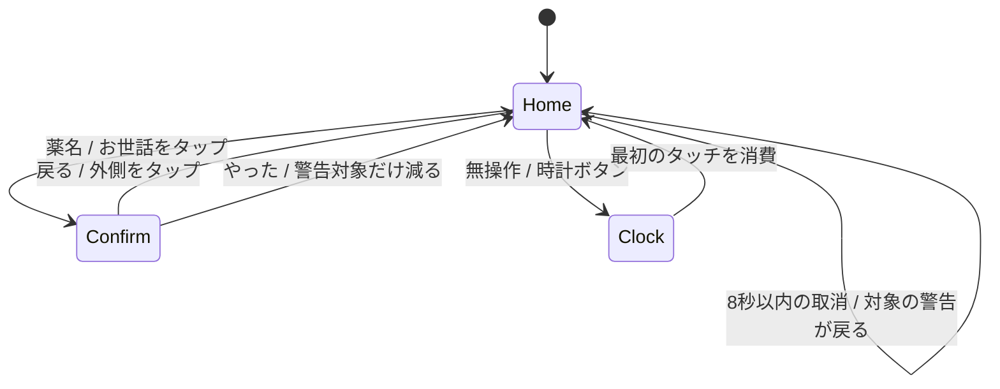

# 投薬を思い出すパネル — 画面設計（改訂3）

2026-10-18 / [要求](prd.md) / [操作モック](prototype.html)。ユーザーの「文字が多い」「次回の日付は不要」「パッと見て思い出せればいい」「予定の二日前から警告」を反映した再設計。さらに「普段は保護メーターだけ」「いつもと違う画面の方が目立つ」という希望を反映し、警告中だけ投薬画面が現れるようにする。

## 画面と遷移

960×480。普段はhogo-meterのお世話3項目を横一列に大きく置く。警告対象がある場合だけ、左にフィラリア・フロントライン等の対象カード、右に小さなお世話3項目へ配置を切り替える。薬が1つなら左の大きなカード1枚、2つなら2枚。上部は猫の名前と現在時刻、時計ボタンだけ。日付は表示しない。

- **ホーム:** 普段は薬名・薬カード・次回日付を出さない。2日前から画面を切り替え、琥珀色の「そろそろ」、当日は「今日」、過ぎたら赤系の「未確認」。実施を記録した薬はカードごと消す。全て記録したら普段のお世話だけに戻る。
- **確認:** 薬名と「戻る」「やった」の2操作。実施済みカードは主画面に残さない。初期フォーカスは「戻る」に置く。日々のお世話も同じ短い確認。
- **結果:** ホームへ戻り、8秒だけ「薬名＋記録しました／取消」。取消で警告が再び現れる。取消後は「取り消しました」。確認画面や時計を開くと取消の受付を閉じる。
- **時計:** フリップ時計の下に、警告対象の薬名だけを琥珀色の札で添える。通常・済の薬名は出さない。通知文や件数は置かない。

確認画面は開いてから450ms、実施ボタンを無効にし、処理側にも同じ時間判定を置く。カードの2回目のタップが背後の位置と重なっても即記録しない。戻る・閉じるはすぐ受け付ける。閉じたら有効化の予約を解除する。

時計の最初のタッチは、指が離れるまで一連のジェスチャーを消費する。時計への切替境界でも同様。モックはクリックで復帰を表し、実機の指・低輝度・無操作時間はまだ検証しない。

## 2日前の判定と実施記録

予定の対象地域における `scheduledDate - 2暦日` の00:00から警告する。20日が予定日なら18日から「そろそろ」。予定日の翌日以降も、その回の記録がない限り「未確認」。時刻・残り日数・次回日付は見せない。モックは2026-10-20を予定日とし、3日前・2日前・当日・翌日を外側の切替ボタンで再現する。実時間は進めない。

内部状態は `normal / soon / today / late / done`。`normal` と `done` は投薬カードを描画しない。`soon / today / late` が1つ以上ある場合だけ警告レイアウトを使う。元予定は外部の定義を正とし、実施は `occurrenceKey` ごとに別保存。「やった」は明示的な自己申告で、予定日や次の周期を自動変更しない。記録済みなら警告より優先する。モックは各薬1回分だけを固定保持し、次の回の生成は省略する。実施後はその回のカードを非表示にする。

系列の表示対象は、警告開始日が到来した回のうち日時が最新の回を、完了状態を問わず選ぶ。新しい回を完了しても古い回を同じカードや時計の警告へ繰り上げない。過去の未確認は保存するが主画面に件数を並べない。過去履歴は別画面として後段で検討する。警告開始前は取得・保持だけ行い、薬を主画面に出さない。

確認を開いた時点の `occurrenceKey` にだけ記録し、データ更新で対象を別の回へ差し替えない。取消は結果表示の8秒以内に限り、このモックからはそれ以後の履歴操作はできない。将来の過去履歴は主画面から分離して設計する。実連携の取消は記録IDと版を確認した打ち消し操作とし、古い状態を無条件に復元しない。実施は現在警告表示中の回へ記録する。通常期間は薬の操作導線を出さない。配置の自動切替は進行中のタッチを終えてから反映し、確認中の対象は維持する。

## 既存コードと将来の連携

既存のHogo Panel `f5f7fbd` は時計のみのAndroid PoC。`app/src/main/kotlin/io/github/ysogabe/hogo/panel/MainActivity.kt:21`、`FlipClockView.kt:34`、`ClockModel.kt:28` を引き継ぎ、待機・復帰・操作画面を後で組み込む。

予定取得 `ScheduleSource`、回ごとの保存 `ExecutionRepository`、2日前の判定 `ReminderPolicy`、画面状態 `PanelUiState`、時計との遷移 `IdleController` を分ける。Googleは専用カレンダーの読み取りを第一候補とし、元の回の識別と端末側の実施を分ける。Tasksの時刻・繰り返しに関する前回調査の制約は継承し、接続段階で再確認する。

日々のお世話は別の `CareSource` でhogo-meterへ記録する。投薬カードの「やった」ではhogo-meterの別項目へ自動送信しない。本番の記録・取消は実APIの成功後に反映する。今回のモックはメモリ内の操作だけ。

## 通信と安全面

固定の架空データとインラインCSS/JSだけで、外部通信・認可・永続保存をしない。薬名・周期は利用者設定。薬量や投薬手順は案内しない。端末情報や本番の記録を公開ファイルに入れない。

実連携では未取得・古い情報・認可エラーと、通常・済を区別し、成功していない記録を済にしない。詳しい接続情報は設定側へ寄せ、主画面は短い状態だけにする。エラー表示、Google認可・トークン・アカウント分離は前案の安全方針を引き継いで接続段階で設計する。

時計への薬名表示は、旧案の件数だけの待機通知を置き換える提案。見て思い出せることを優先する。バックライトを自動で明るくしたり、点滅・音で割り込む動作は追加しない。警告がなければ既存の低輝度時計だけにする。`IDLE_CLOCK.md` の正式な変更は画面方針の決定後。

## 検証と次の段階

[verification.md](verification.md) に確認を記録する。AC1〜AC6はHTMLの構文・描画・操作で確認。実機で時計中の札に気づけるか・低輝度での読みやすさ、時計復帰ジェスチャー、再起動後の保存と実APIは次段階。

1. 今回: 文字を絞った画面案と2日前の警告・実施確認。
2. 方針が決まったらAndroidのmock実装で実機確認。
3. hogo-meter、Google、家族共有を順に追加。
